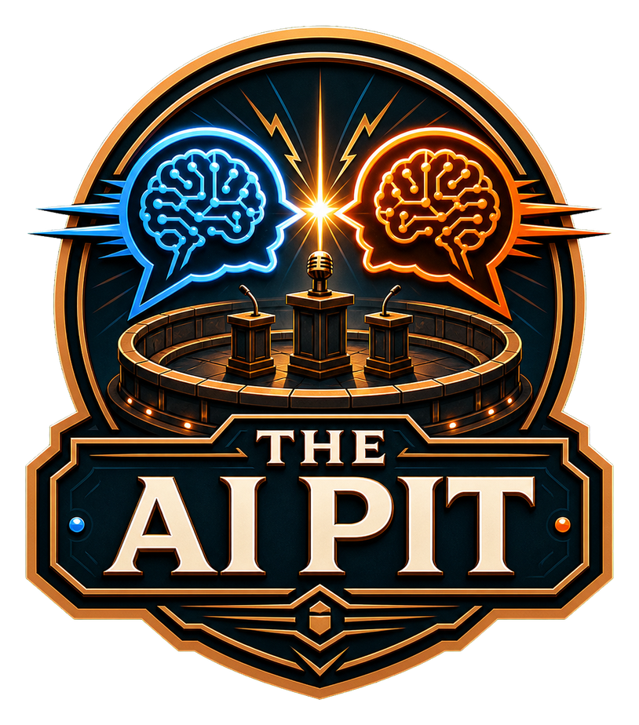

<p align="center">
  
  <br />
  <!-- repo-tagline:start -->
  <strong>🔥 Where AI personas clash in moderator-led debates 🔥</strong>
  <!-- repo-tagline:end -->
</p>

The AI Pit stages a debate between AI personas. Choose a topic, a moderator,
and up to three debaters. Follow their opening statements, rounds, and final
synthesis.

## Try it

Open [The AI Pit](https://aipit.tsilva.eu) and start with a preset lineup or
choose the participants yourself. A finished debate can be shared as a
snapshot.

## Run locally

Use the Node.js and npm versions listed in the
[development guide](docs/development.md#install). From a checkout:

```bash
npm ci
npm run dev -- --port auto
```

Open the printed URL. See the [development guide](docs/development.md) for
provider configuration and checks, and [production delivery](docs/production-delivery.md)
for deployment.

## License

[MIT License](LICENSE).
