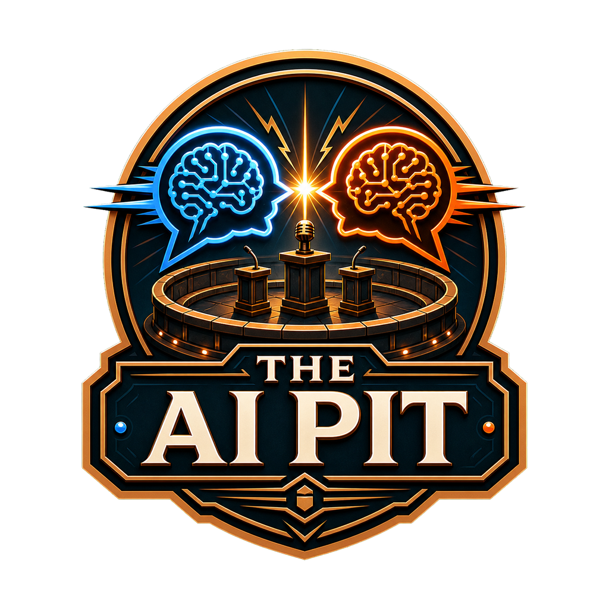
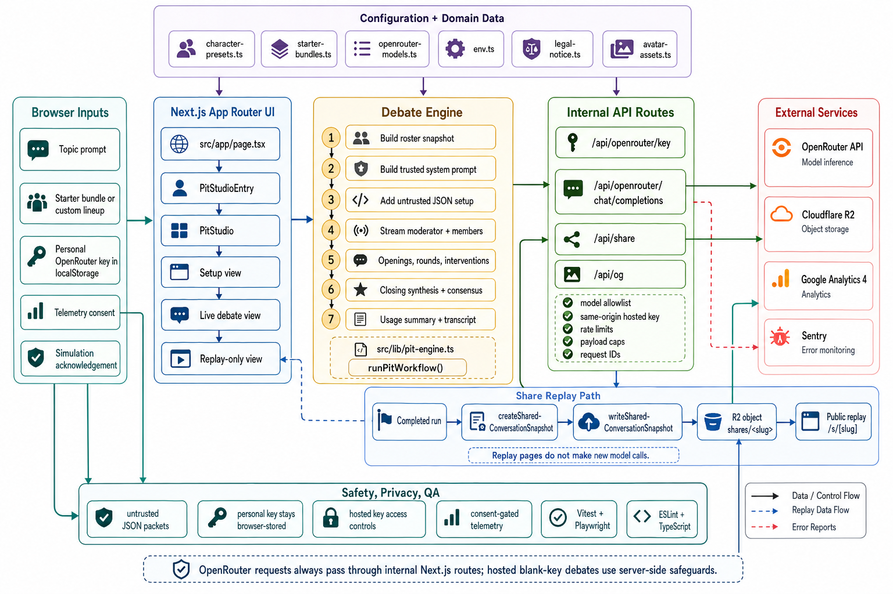

<p align="center">
  
  <br />
  <!-- repo-tagline:start -->
  <strong>🔥 Where AI personas clash in moderator-led debates 🔥</strong>
  <!-- repo-tagline:end -->
</p>

<p><a href="https://aipit.tsilva.eu">Live Demo</a> · <a href="https://github.com/tsilva/aipit">GitHub</a></p>

The AI Pit turns a topic into a structured debate with a moderator, multiple AI participants, opening statements, rounds, interventions, and a closing synthesis. It is built with Next.js, React, Tailwind CSS, and OpenRouter.

Use the preset characters and starter bundles to begin quickly, or build a custom lineup with up to four people total: one moderator and as many as three debaters. Random lineups sample eligible personalities directly, with Portuguese personalities included only for clients in Portugal. Completed debates can be saved as replay links when Cloudflare R2 storage is configured.

## Install

Requires Node.js 20.17+ (20.x) or 22.9+ and npm 11.16.0, pinned in `package.json`.

```bash
git clone https://github.com/tsilva/aipit.git
cd aipit
npm install --global "$(node -p "require('./package.json').packageManager")" --ignore-scripts
npm ci
npm run dev:secrets
```

Use `npm ci` to install the committed `package-lock.json`; use `npm install` when intentionally updating dependencies. `.npmrc` enforces a seven-day minimum release age for dependency resolution and disables installation lifecycle scripts. CI uses the same pinned npm version and explicitly installs the Playwright browser separately.

Debates use the server’s configured model provider. Personal OpenRouter keys are no longer accepted or saved. Same-origin checks, rate limits, model allowlisting, and payload caps apply to every request.

## Commands

```bash
npm run dev
npm run dev:secrets
npm run secrets:check
npm run secrets:add -- AGENTBRIDGE_API_KEY # add a development key with hidden value input
npm run build:secrets
npm run start:secrets
npm run build         # generate avatar asset versions and build production output
npm run start         # serve the production build
npm run lint          # run ESLint
npm run typecheck     # run TypeScript checks
npm run test          # run Vitest tests
npm run test:e2e      # run Playwright tests
npm run sentry:issues # query Sentry issues with a read-only token
```

## Configuration

```bash
NEXT_PUBLIC_SITE_URL=http://localhost:3000
NEXT_PUBLIC_OPENROUTER_APP_NAME=The AI Pit
AGENTBRIDGE_API_KEY=
```

Optional production features use these variables:

```bash
NEXT_PUBLIC_GA_MEASUREMENT_ID= # Google Analytics 4
NEXT_PUBLIC_SENTRY_DSN=        # browser Sentry DSN
NEXT_PUBLIC_SENTRY_ENABLED=    # force Sentry outside production
SENTRY_DSN=                    # server Sentry DSN
SENTRY_AUTH_TOKEN=             # source map upload; org:ci build token
SENTRY_SMOKE_TEST_TOKEN=       # optional protected deployment diagnostic
SENTRY_ORG=                    # defaults to tsilva
SENTRY_PROJECT=                # defaults to aipit
SENTRY_BASE_URL=https://sentry.io

R2_ACCOUNT_ID=                 # required for share links
R2_BUCKET_NAME=                # required for share links
R2_ACCESS_KEY_ID=              # required for share links
R2_SECRET_ACCESS_KEY=          # required for share links
R2_OBJECT_PREFIX=shares/       # optional share snapshot prefix
```

`NEXT_PUBLIC_SITE_URL` should be set in production unless the deployment platform provides a canonical Vercel URL.

Local development and Vercel Preview use the private `aipit-development` R2
bucket with a dedicated non-production token. Production keeps `aipit` and a
different token restricted to that bucket. Set local `R2_BUCKET_NAME` to
`aipit-development` in the ignored `.env`; credentials come from the pinned
Development Infisical project. Keep Preview's `NEXT_PUBLIC_SITE_URL` unset so
share links use that deployment's URL. See [R2 environment isolation](docs/production-delivery.md#r2-environments).

Sentry delivery must be confirmed with an event received in the expected project.
The [delivery verification procedure](docs/sentry-delivery.md) covers consent,
production commit checks, and the read-only `scripts/verify-sentry-delivery.mjs`
verifier. Browser events use the deployment environment, unless `SENTRY_ENVIRONMENT`
explicitly overrides it. Obtain approval before synthetic events or deployment.

## Notes

- OpenRouter calls go through the internal Next.js routes under `src/app/api/openrouter`.
- Debates use the server’s configured model provider; personal provider keys are not accepted or stored.
- The server applies same-origin checks, rate limits, model allowlisting, and payload caps to every model request.
- Share links are public-by-URL replay snapshots stored in Cloudflare R2. Replay pages do not make new model calls.
- Google Analytics and browser Sentry are optional and respect the app's onboarding privacy preference controls.
- Avatar assets in `public/avatars` are served with long-lived cache headers and versioned by `scripts/generate-avatar-asset-versions.mjs`.
- The app is an experimental AI simulation, not an advice service or official communications channel.

## Architecture



## License

[MIT](LICENSE)

## Model routing

Development uses AgentBridge (`AGENTBRIDGE_BASE_URL`, default
`http://127.0.0.1:8082/api/v1`, and optional `AGENTBRIDGE_API_KEY`).
Production and Preview call OpenRouter directly using their own server-only
`OPENROUTER_API_KEY`; a missing production key disables model requests.
Production credentials come from this app’s isolated Infisical project.
Production text requests use `deepseek/deepseek-v4.1-flash` with reasoning disabled.
